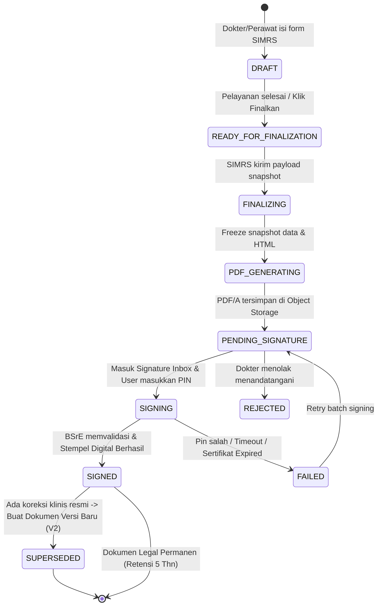

# DOKUMEN ARSITEKTUR & PERANCANGAN SISTEM
## SIMRS Document & TTE Service — Integrasi BSrE BSSN
**RSUD Dokter Mohammad Saleh Kota Probolinggo**

---

## 1. Ringkasan Eksekutif & Jawaban Arsitektur Kunci

### Integrasi Dua Database: PostgreSQL (Document Service) & MySQL (SIMRS)
> **Pertanyaan Arsitektural:**  
> *Apakah aman dan bisa mengintegrasikan Document & TTE Service yang menggunakan PostgreSQL (+ pgvector) dengan SIMRS existing yang menggunakan MySQL?*

**Jawaban:** **Sangat BISA, SANGAT AMAN, dan merupakan STANDAR EMAS (Best Practice) Microservice Architecture (*Database-per-Service Pattern*).**

#### Alasan Teknis:
1. **Isolasi Beban I/O Tinggi**:  
   Proses penandatanganan puluhan dokumen sekaligus (*batch signing*), rendering PDF/A, dan pencatatan audit trail menghasilkan beban I/O yang sangat tinggi. Memisahkannya ke PostgreSQL memastikan performa transaksi medis utama di MySQL SIMRS (pendaftaran, rekam medis klinis, billing kasir) tetap stabil, cepat, dan terbebas dari lonjakan beban TTE.
2. **Kekuatan Native PostgreSQL**:  
   - **JSONB**: Penyimpanan snapshot dokumen medis tak terstruktur secara *immutable* dengan indeks GIN berkecepatan tinggi.
   - **pgvector**: Ekstensi pencarian kemiripan semantik (*semantic similarity search*) terhadap resume medis dan diagnosis pasien.
3. **Pola Integrasi Tanpa Risiko Inkonsistensi**:
   - **Tanpa Cross-Database SQL Join**: Service tidak melakukan query database silang (cross-DB join).
   - **Logical Reference Key**: Dokumen dihubungkan melalui *logical key* yang jelas: `simrs_kunjungan_id` (*nopen*), `simrs_pasien_id` (*norm*), `simrs_document_ref_id`, `dokter_nik`, `dokter_user_id`.
   - **Komunikasi Asinkron & REST API**: Komunikasi dilakukan via `DocumentServiceClient` di Laravel SIMRS dengan dukungan *Transactional Outbox / Idempotency Key* untuk mencegah dokumen hilang saat terjadi gangguan jaringan sementara.

---

## 2. A. Existing Architecture Report

Berdasarkan arsitektur SIMRS Vue + Quasar (JavaScript murni) dan Laravel REST API:

1. **Penyusunan HTML Dokumen**:
   - Dokumen medis (Resume Medis, CPPT, Surat Kematian, Lembar Konsultasi, Informed Consent, Asesmen Bedah/Anestesi) dirender sebagai komponen Vue menggunakan format cetak CSS A4/Folio (`@media print`).
   - Data dinamis diinjeksi via props/API response ke dalam struktur tabel/grid HTML.
2. **Mekanisme Cetak Existing**:
   - Mengandalkan dialog cetak browser bawaan (`window.print()`) melalui jendela pop-up atau tab baru. Dokumen belum berwujud file PDF permanen di server saat dicetak.
3. **Pengambilan Data dari Laravel**:
   - Controller Laravel mengembalikan data relasional pasien, kunjungan, diagnosis (ICD-10), tindakan (ICD-9-CM), catatan perkembangan (SOAP), dan DPJP via REST API JSON.
4. **Hubungan Dokumen & Episode Pelayanan**:
   - Seluruh dokumen terikat ketat pada identitas pasien (`norm`) dan episode registrasi rawat jalan/inap/IGD (`nopen` / `kunjungan_id`).
5. **Autentikasi & Otorisasi**:
   - Menggunakan token bearer (Laravel Sanctum/Passport). Pengguna memiliki atribut NIK, SIP, ID Dokter, serta role (*Dokter DPJP*, *Perawat*, *PPA Lainnya*).
6. **Status Dokumen Existing**:
   - Hanya memiliki status data transaksional sederhana (misal: *draft* vs *tersimpan*). Belum ada *state machine* legalitas dokumen medis elektronik (Permenkes 24/2022) yang memiliki *immutability check*.
7. **Penyimpanan Berkas**:
   - Belum ada *object storage* terpusat (MinIO/S3). Dokumen yang telah dicetak hanya dapat direproduksi dengan me-render ulang data dari database SIMRS (berisiko berubah jika data rekam medis di kemudian hari diedit).

---

## 3. B. Proposed Architecture

```
+---------------------------------------------------------------------------------------------------+
|                                      SIMRS ECOSYSTEM                                              |
|                                                                                                   |
|  +-------------------------+      REST API (JSON)      +---------------------------------------+  |
|  |     SIMRS Frontend      | <=======================> |             SIMRS Backend             |  |
|  |  (Vue + Quasar JS)      |                           |               (Laravel)               |  |
|  |  - Form Pelayanan       |                           |  - Master Pasien, EMR, Kunjungan      |  |
|  |  - HTML Preview         |                           |  - Transaksi Klinis (MySQL)           |  |
|  |  - Signature Inbox      |                           |  - DocumentServiceClient (Wrapper)    |  |
|  +-------------------------+                           +---------------------------------------+  |
|               ^                                                            |                      |
+---------------|------------------------------------------------------------|----------------------+
                |                                                            | Internal REST API
                | Direct API (JWT Bearer)                                    | (mTLS / Service Token)
                v                                                            v
+---------------------------------------------------------------------------------------------------+
|                               DOCUMENT & TTE MICROSERVICE (FastAPI)                               |
|                                                                                                   |
|  +---------------------------------------------------------------------------------------------+  |
|  | Controller Layer:                                                                           |  |
|  | - Ingestion / Finalization Controller       - Signature Inbox & Batch Controller            |  |
|  | - Document Verification Controller          - Audit Trail & Monitoring Controller           |  |
|  +---------------------------------------------------------------------------------------------+  |
|                                                |                                                  |
|  +---------------------------------------------v-----------------------------------------------+  |
|  | Service & Core Engine Layer:                                                                |  |
|  | - DocumentLifecycleManager (State Machine: Draft -> Finalized -> Pending -> Signed)         |  |
|  | - SnapshotEngine (Data Freeze & Template Versioning)                                        |  |
|  | - PdfRenderer (HTML/CSS to PDF/A-1b standard)                                               |  |
|  | - SignatureProvider Abstraction (BSrE Adapter / Mock Sandbox Engine)                        |  |
|  | - VirusScanner (ClamAV Daemon Integration)                                                  |  |
|  +---------------------------------------------------------------------------------------------+  |
|            |                                   |                               |                  |
|            v                                   v                               v                  |
|  +--------------------+             +--------------------+           +--------------------+       |
|  | Document Database  |             | Object Storage     |           | BSrE Server (BSSN) |       |
|  | (PostgreSQL 16)    |             | (MinIO / S3)       |           | - Esign Client     |       |
|  | - documents        |             | - /original.pdf    |           | - Verify API       |       |
|  | - versions/snapshot|             | - /signed.pdf      |           | - Status API       |       |
|  | - audit_logs       |             | - /manifest.json   |           +--------------------+       |
|  | - pgvector         |             +--------------------+                                        |
|  +--------------------+                                                                           |
+---------------------------------------------------------------------------------------------------+
```

---

## 4. C. Gap Analysis

| Aspek | Kondisi Saat Ini (AS-IS) | Kondisi Baru (TO-BE Target) |
| :--- | :--- | :--- |
| **Format Dokumen** | HTML dinamis dirender di browser (*ephemeral*). | PDF/A tersimpan permanen di Object Storage yang identik dengan tampilan cetak. |
| **Legalitas Hukum** | Tanda tangan basah atau QR code dummy tanpa sertifikat elektronik. | Sertifikat Digital tersertifikasi BSrE BSSN (Klausul UU ITE & Permenkes 24/2022). |
| **Integritas Data** | Jika data di SIMRS berubah setelah dicetak, cetakan lama tidak dapat diverifikasi. | **Immutable Snapshot**: Data dan PDF disegel hash SHA-256; koreksi pasca-TTE melahirkan Versi Baru (V2, V3). |
| **Beban Kerja Dokter** | Dokter harus membuka setiap form satu per satu untuk menandatangani. | **Signature Inbox Terpusat**: Dokter menandatangani 15-50 dokumen sekaligus dalam 1 kali otorisasi (*Batch Signing*). |
| **Ketersediaan Layanan** | Cetak langsung bergantung pada database MySQL SIMRS. | SIMRS tetap dapat melayani pasien meskipun jaringan BSrE BSSN sedang mengalami gangguan (*graceful degradation*). |

---

## 5. D. Recommended Database Schema (PostgreSQL 16)

```sql
-- 1. EXTENSIONS
CREATE EXTENSION IF NOT EXISTS "uuid-ossp";
CREATE EXTENSION IF NOT EXISTS vector;

-- 2. MASTER DOCUMENT TYPES
CREATE TABLE document_types (
    id SERIAL PRIMARY KEY,
    code VARCHAR(50) UNIQUE NOT NULL,      -- 'RESUME_MEDIS', 'SURAT_KEMATIAN', 'CPPT', 'INFORMED_CONSENT'
    name VARCHAR(150) NOT NULL,
    category VARCHAR(50) NOT NULL,        -- 'MEDIS', 'KEPERAWATAN', 'LEGAL', 'PENUNJANG'
    requires_multisigner BOOLEAN DEFAULT FALSE,
    retention_years INT DEFAULT 5,         -- Permenkes: minimal 5 tahun
    created_at TIMESTAMPTZ DEFAULT NOW()
);

-- 3. CORE DOCUMENTS (Header Metadata)
CREATE TABLE documents (
    id UUID PRIMARY KEY DEFAULT uuid_generate_v4(),
    document_number VARCHAR(100) UNIQUE,  -- Nomor Dokumen Resmi Rumah Sakit
    document_type_code VARCHAR(50) REFERENCES document_types(code),
    simrs_kunjungan_id VARCHAR(64) NOT NULL,
    simrs_pasien_id VARCHAR(64) NOT NULL,
    pasien_norm VARCHAR(20) NOT NULL,
    pasien_nama VARCHAR(150) NOT NULL,
    unit_layanan VARCHAR(100),            -- Poli Jantung, IGD, Flamboyan, dll.
    current_version INT DEFAULT 1,
    status VARCHAR(30) NOT NULL DEFAULT 'DRAFT', 
    -- Status: DRAFT, READY_FOR_FINALIZATION, FINALIZING, PDF_GENERATING, PENDING_SIGNATURE, SIGNING, SIGNED, FAILED, REJECTED, CANCELLED, SUPERSEDED
    priority VARCHAR(10) DEFAULT 'NORMAL', -- 'URGENT', 'HIGH', 'NORMAL', 'LOW'
    created_by VARCHAR(50) NOT NULL,       -- ID User SIMRS
    created_at TIMESTAMPTZ DEFAULT NOW(),
    updated_at TIMESTAMPTZ DEFAULT NOW()
);

-- 4. DOCUMENT VERSIONS & SNAPSHOTS (Immutable)
CREATE TABLE document_versions (
    id UUID PRIMARY KEY DEFAULT uuid_generate_v4(),
    document_id UUID REFERENCES documents(id) ON DELETE CASCADE,
    version_number INT NOT NULL,
    snapshot_data JSONB NOT NULL,          -- Seluruh payload data klinis saat finalisasi
    html_snapshot_hash VARCHAR(64),        -- SHA-256 dari HTML template yang dirender
    pdf_storage_path VARCHAR(500),         -- Path ke Object Storage (original.pdf)
    signed_pdf_storage_path VARCHAR(500),  -- Path ke Object Storage (signed.pdf)
    pdf_sha256 VARCHAR(64),                -- Hash SHA-256 PDF asli
    signed_pdf_sha256 VARCHAR(64),         -- Hash SHA-256 PDF setelah TTE
    embedding VECTOR(1536),                -- Vektor semantic resume medis
    is_active BOOLEAN DEFAULT TRUE,
    created_at TIMESTAMPTZ DEFAULT NOW(),
    UNIQUE(document_id, version_number)
);

-- 5. DOCUMENT SIGNERS (Mendukung Multi-Signer & Status Individu)
CREATE TABLE document_signers (
    id UUID PRIMARY KEY DEFAULT uuid_generate_v4(),
    document_version_id UUID REFERENCES document_versions(id) ON DELETE CASCADE,
    signer_nik VARCHAR(20) NOT NULL,       -- NIK terdaftar di BSrE BSSN
    signer_name VARCHAR(150) NOT NULL,
    signer_role VARCHAR(50) NOT NULL,      -- 'DPJP', 'DOKTER_OPERATOR', 'DOKTER_ANESTESI', 'PERAWAT', 'PASIEN'
    signature_type VARCHAR(20) DEFAULT 'BSRE', -- 'BSRE', 'MANUAL_PAD', 'WITNESS'
    signing_order INT DEFAULT 1,           -- 1 = pertama, 2 = kedua (sequential)
    status VARCHAR(20) DEFAULT 'WAITING',  -- 'WAITING', 'NOTIFIED', 'SIGNED', 'FAILED', 'REJECTED'
    signed_at TIMESTAMPTZ,
    bsre_transaction_id VARCHAR(100),      -- ID Transaksi dari BSSN
    error_message TEXT,
    created_at TIMESTAMPTZ DEFAULT NOW()
);

-- 6. AUDIT TRAIL LOGS (Kriteria Kepatuhan BSrE & Medis)
CREATE TABLE document_audit_logs (
    id BIGSERIAL PRIMARY KEY,
    document_id UUID REFERENCES documents(id),
    action VARCHAR(50) NOT NULL,           -- 'FINALIZE', 'GENERATE_PDF', 'SUBMIT_TTE', 'BSRE_SUCCESS', 'BSRE_FAILED', 'VERIFY'
    actor_id VARCHAR(50) NOT NULL,
    actor_name VARCHAR(150) NOT NULL,
    actor_role VARCHAR(50) NOT NULL,
    ip_address VARCHAR(50),
    user_agent TEXT,
    details JSONB,
    created_at TIMESTAMPTZ DEFAULT NOW()
);
```

---

## 6. E. API Contract (SIMRS Laravel ⟷ Document Service)

### 1. Finalisasi Dokumen dari SIMRS
* **Endpoint**: `POST /api/v1/documents/finalize`
* **Headers**: `Authorization: Bearer <service_token>`
* **Payload**:
```json
{
  "document_type": "RESUME_MEDIS",
  "document_number": "RM/2026/10/0042",
  "kunjungan_id": "2610260012",
  "pasien_id": "00289114",
  "pasien_norm": "00-28-91-14",
  "pasien_nama": "Tn. Bambang Sutrisno",
  "unit_layanan": "Poli Jantung",
  "priority": "HIGH",
  "signers": [
    {
      "nik": "3574012304850001",
      "name": "dr. Hendra Sp.JP",
      "role": "DPJP",
      "signing_order": 1,
      "signature_type": "BSRE"
    }
  ],
  "html_content": "<div class='print-document'>...konten html dari template existing...</div>",
  "snapshot_data": {
    "diagnosa_utama": "I20.0 - Unstable Angina",
    "terapi": "Aspilet 80mg, ISDN 5mg",
    "tanggal_kunjungan": "2026-10-26"
  }
}
```
* **Response**: `202 Accepted` (`{"document_id": "uuid", "status": "FINALIZING", "version": 1}`)

### 2. Signature Inbox Dokter
* **Endpoint**: `GET /api/v1/inbox/pending?nik=3574012304850001&time_range=today&type=RESUME_MEDIS`
* **Response**:
```json
{
  "total": 12,
  "data": [
    {
      "document_id": "uuid-1",
      "document_type": "RESUME_MEDIS",
      "document_number": "RM/2026/10/0042",
      "pasien_norm": "00-28-91-14",
      "pasien_nama": "Tn. Bambang Sutrisno",
      "unit_layanan": "Poli Jantung",
      "finalized_at": "2026-10-26T14:10:00+07:00",
      "priority": "HIGH",
      "preview_url": "/api/v1/documents/uuid-1/preview"
    }
  ]
}
```

### 3. Batch TTE Execution
* **Endpoint**: `POST /api/v1/tte/batch-sign`
* **Payload**:
```json
{
  "signer_nik": "3574012304850001",
  "passphrase": "pin_bsre_dokter",
  "document_ids": ["uuid-1", "uuid-2", "uuid-3"]
}
```
* **Response**:
```json
{
  "total_processed": 3,
  "successful": 3,
  "failed": 0,
  "details": [
    { "document_id": "uuid-1", "status": "SIGNED", "tx_id": "BSSN-2026-001" },
    { "document_id": "uuid-2", "status": "SIGNED", "tx_id": "BSSN-2026-002" },
    { "document_id": "uuid-3", "status": "SIGNED", "tx_id": "BSSN-2026-003" }
  ]
}
```

---

## 7. F. Document Lifecycle Diagram



---

## 8. G. Signature Inbox UX Proposal (Quasar + Tailwind JavaScript)

Halaman ini didesain sebagai widget terintegrasi di SIMRS tanpa mengganggu menu utama:

1. **Header Ringkasan**:
   - Badge Counter Merah: Menampilkan jumlah dokumen menunggu TTE (misal: **32 Dokumen Perlu TTE**).
   - Pengelompokan Tab Waktu: `Hari Ini (14)` | `Kemarin (10)` | `2-7 Hari Lalu (6)` | `> 7 Hari (2)`.
2. **Filter Multi-Dimensi**:
   - Filter Jenis Dokumen: *Semua*, *Resume Medis*, *CPPT*, *Surat Kematian*, *Informed Consent*.
   - Filter Prioritas: *Cito/Tinggi*, *Normal*.
   - Pencarian Pasien (No. RM / Nama).
3. **Tabel Antrean Dokumen**:
   - Checkbox seleksi per baris dan tombol **"Pilih Semua pada Filter Ini"**.
   - Kolom: Waktu Finalisasi, Prioritas, No. RM & Pasien, Jenis Dokumen, Unit Layanan, Tombol Aksi *(Preview Inline)*.
4. **Alur Konfirmasi Sadar (Explicit User Consent)**:
   - Sebelum tombol TTE aktif, modal pop-up menampilkan:
     - Jumlah dokumen yang dipilih (misal: **15 Dokumen**).
     - Rincian ringkas: 8 CPPT, 4 Resume Medis, 3 Surat Kontrol.
     - Kolom Passphrase BSrE yang aman (tidak disimpan di memori browser).
   - Indikator Progress Bar real-time: `Menandatangani 8 dari 15...`
   - Rekonsiliasi Hasil: Jika ada dokumen gagal (misal 13 sukses, 2 gagal karena format metadata), dokumen sukses otomatis berubah status jadi `SIGNED` dan diarsipkan, sedangkan 2 dokumen gagal tetap di inbox dengan keterangan error yang jelas untuk di-*retry*.

---

## 9. H. BSrE Integration Assumptions

Sesuai **Petunjuk Teknis API Esign Client v2.2.1** dan **Pedoman Kriteria Integrasi Sistem BSrE BSSN**:

1. **Keamanan Kredensial**: Passphrase/PIN dokter **TIDAK PERNAH** disimpan di database maupun log audit. Passphrase hanya dikirim sekali lewat memori transit terenkripsi (TLS) saat memanggil API BSrE.
2. **Batch Signing di BSrE**: 
   - Di tingkat kriptografis BSSN, sertifikat digital diterapkan per file PDF unik (karena hash sertifikat mengikat satu dokumen spesifik).
   - Di sisi UX, sistem menyediakan *Single Authorization Batching*: pengguna menginput PIN sekali, dan `BSrESignatureProvider` memproses antrean dokumen secara concurrent/sekuensial berkecepatan tinggi dengan session token yang valid.
3. **QR Code Stamping Visual**:
   - Posisi stempel QR code diletakkan di koordinat halaman terakhir yang telah distandarkan per template dokumen agar tidak menutupi isi catatan medis.
   - QR code berisi URL verifikasi resmi (`/verify/{document_id}`) yang dapat dipindai oleh publik/pasien untuk memvalidasi keaslian dokumen.

---

## 10. I. Implementation Plan (Phases 0 — 6)

```
[Phase 0: Discovery & Architecture Baseline]  <--- STATUS: SELESAI (Perancangan)
  │  Periksa kode repo SIMRS Vue & Laravel, identifikasi path template dokumen.
  ▼
[Phase 1: Document Core & Schema Setup]
  │  Deploy schema PostgreSQL, lifecycle state machine, immutability snapshot.
  ▼
[Phase 2: PDF Rendering Engine & MinIO Storage]
  │  Docker container MinIO, renderer HTML-to-PDF preservasi style CSS A4 SIMRS.
  ▼
[Phase 3: Signature Inbox Frontend Widget]
  │  Integrasikan widget Inbox ke Quasar SIMRS (murni JavaScript, Tailwind UI).
  ▼
[Phase 4: BSrE Adapter & Batch Signing]
  │  Hubungkan BSrE Adapter (dengan safe fallback sandbox lokal untuk dev).
  ▼
[Phase 5: Multi-Signer & Approval Flow]
  │  Alur Laporan Operasi & Informed Consent (Dokter DPJP + Anestesi / Pasien).
  ▼
[Phase 6: Production Hardening, Audit & Pilot Rollout]
     Healthcheck, audit trail, stress test batch signing 50 dokumen, go-live pilot.
```

---

## 11. J. File-by-File Implementation Plan

### 1. Document & TTE Service (Python FastAPI)
* `backend/app/Models/DocumentModel.py`: Model relasional SQLAlchemy/SQLModel (Dokumen, Versi, Signer, Audit).
* `backend/app/Services/DocumentLifecycleService.py`: State machine transisi status dokumen.
* `backend/app/Services/HtmlToPdfService.py`: Engine konversi HTML SIMRS ke PDF/A.
* `backend/app/Services/StorageService.py`: Abstraksi MinIO S3 Object Storage.
* `backend/app/Services/BsreSignatureProvider.py`: Provider integrasi API BSrE BSSN.
* `backend/app/Http/Controllers/FinalizationController.py`: Endpoint penerima payload dari Laravel SIMRS.
* `backend/app/Http/Controllers/InboxController.py`: Endpoint antrean TTE dokter/perawat/PPA.

### 2. SIMRS Laravel Integration (`simrs/app/`)
* `app/Services/DocumentServiceClient.php`: Guzzle HTTP client untuk komunikasi ke Document Service (create, finalize, fetch status).
* `app/Jobs/SendDocumentToFinalizeJob.php`: Laravel Queue Job agar proses finalisasi tidak membebani transaksi klinis dokter.
* `app/Traits/HasDigitalDocument.php`: Trait untuk model Resume Medis, CPPT, Surat Kematian.

### 3. SIMRS Frontend Widget (`simrs/src/`)
* `src/widgets/SignatureInbox.vue`: Halaman antrean TTE terpusat (Vue + Quasar JS + Tailwind).
* `src/widgets/DocumentPreviewModal.vue`: Modal preview PDF / HTML snapshot sebelum TTE.
* `src/widgets/BatchConfirmDialog.vue`: Dialog konfirmasi sadar & input passphrase BSrE.

---

## 12. Aturan Implementasi Wajib (Golden Rules)

1. **Jangan mengubah alur kerja klinis dokter/perawat** di SIMRS yang sudah berjalan.
2. **Jangan mendesain ulang seluruh HTML dokumen** yang sudah ada di SIMRS.
3. **Jangan menyimpan file PDF sebagai BLOB** di database MySQL SIMRS.
4. **Gunakan JavaScript murni (bukan TypeScript)** untuk frontend widget Quasar sesuai standar SIMRS existing.
5. **Setiap dokumen memiliki ID, versi, dan audit trail unik**, batch signing hanya mengelompokkan proses otorisasi pengguna.
6. **Immutable Signed PDF**: Dokumen yang sudah ditandatangani BSrE tidak boleh diubah atau di-generate ulang. Jika ada revisi medis, buat Versi Baru (V2).
